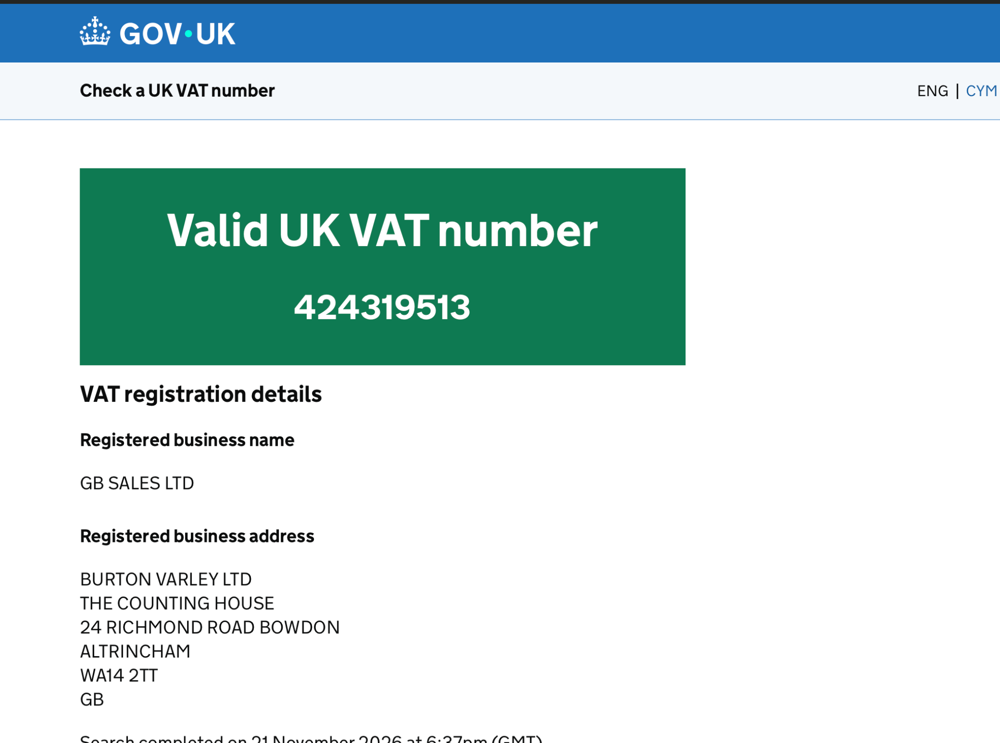
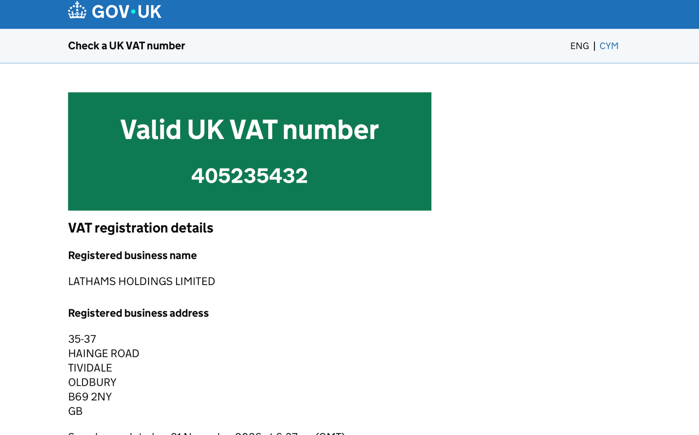
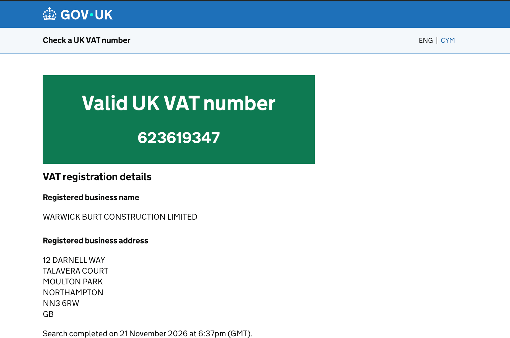

# UK VAT Identifier Discovery – Research Report

Experiment date: 21 November 2026 • Working sample: 30 UK companies

**Main result: I found three VAT numbers through manual research and checked all three using HMRC. Two Python methods found none automatically. A third, combined method found one VAT candidate in a live search, which matched an earlier HMRC check.**

AI assistance: ChatGPT provided the list of 30 companies and helped me write and debug the Python scripts. I personally tested all three programs on my Mac, ran the live searches, checked the CSV results and search logs, and verified the three VAT numbers on HMRC. The results in this report come from my own tests.

This report explains what I tried, what worked, what failed and how I would improve the project.

# Part 1 — Research

## What surprised me

At first, I thought Companies House might show VAT numbers. I searched for companies such as Shell and Rolls-Royce and learned that it provides company details, but not VAT numbers. HMRC can check a VAT number, but it cannot find one from a company name alone. [S1–S2]

I learned that some VAT numbers are public, but finding the correct number for the correct business is difficult, especially with an automated program.

## Sources and experiments

Companies House helped me identify firms and find their addresses. I also tried company websites and public business directories. The directories were the most useful for manual VAT searches. HMRC was useful for checking the numbers I found. [S1–S3; E1]

First, I ran python3 vat_finder.py --live for all 30 companies. It found 0 VAT numbers. Some searches returned irrelevant pages: for example, searching for 10 Pavement Management returned Wikipedia pages about the number 10. Other searches failed or could not open pages. [E2]

Next, I ran python3 vat_postcode.py, hoping postcodes would make the searches more accurate. The result was still 0/30. The program reported restricted access for 28 companies and missing postcodes for two. This is a limitation of the test, not proof that those firms have no VAT number. [E3]

Finally, I ran python3 vat_pipeline.py --live, combining company names, address information and several search methods. It found one candidate: 623619347 for WARWICK BURT CONSTRUCTION LIMITED. The number appeared beside the company name on a VAT Lookup page. It also matched my earlier HMRC check. [E4–E5]

**Evidence: Experiment 1 — experiment_1_audit.csv; Experiment 2 — experiment_2_terminal_record.txt; Experiment 3 — experiment_3_candidates.csv; HMRC screenshot — hmrc_3_warwick_burt.png.**

# Part 2 — Proof of Concept

## The sample of companies

ChatGPT helped me make the starting list of 30 UK companies using Companies House data, and it provided me with the names. Two companies were later replaced manually to keep the final list in England. This means the final sample is not fully random. I did not choose the companies because I already knew their VAT numbers. [S1; E6]

This was a small test sample, not a sample that represents all UK suppliers. The company list is saved in companies.csv.

## Results

| Method                       | Result                                        | Evidence |
|------------------------------|-----------------------------------------------|----------|
| Manual public-web research   | 3 VAT numbers found and checked on HMRC       | E1, E5   |
| Python 1 — general searches  | 0/30 candidate VAT numbers                    | E2       |
| Python 2 — postcode searches | 0/30; 28 access-limited, 2 missing postcodes  | E3       |
| Python 3 — combined searches | 1/30 live candidate; matched prior HMRC check | E4, E5   |

The combined program made 90 searches and tried to open 179 pages. The log records 87 successful page accesses and 92 other results, including blocked or unsupported pages. It found 1 VAT candidate; 27 firms had access problems and 2 had no number in the pages checked. [E4]

## HMRC checks

| **Company (Companies House no.)**            | **VAT**   | **Official result**        |
|----------------------------------------------|-----------|----------------------------|
| GB SALES LTD (12952353)                      | 424319513 | Valid; matching legal name |
| LATHAMS HOLDINGS LIMITED (11383949)          | 405235432 | Valid; matching legal name |
| WARWICK BURT CONSTRUCTION LIMITED (02811195) | 623619347 | Valid; matching legal name |

I personally checked three numbers on the official HMRC website on 21 November 2026 and saved the screenshots. HMRC showed the expected company name in each case. These checks were done manually, not by Python. [E5]

Of the three numbers checked, all three matched the expected business name. I observed 0 wrong matches out of 3, but this is too small a sample to claim a 0% error rate for a real product.

Manual research found and confirmed 3 numbers out of 30 (10%). The final Python live run found 1 candidate out of 30 (3.3%). These results describe this test only: I did not search every company equally deeply, and many pages could not be opened.

## What the Python script does

ChatGPT helped me write and fix the Python programs. I personally ran and tested all three scripts on my Mac, including the demo and live searches, and reviewed the results. The final script searches public pages, looks for VAT numbers close to company names, and saves results and audit logs. It does not check HMRC automatically. The numbers shown in demo mode are examples, not live discoveries.

# Part 3 — What I would do with real resources

With ChatGPT's help, I developed a Python prototype that takes company information, searches public sources and tries to find VAT numbers. I tested the programs myself on my Mac. In the final live experiment, the prototype found one VAT number that matched my earlier HMRC verification, out of 30 companies.

With more resources, I would improve this program rather than start again.

First, I would connect the program to Companies House to look up company numbers, addresses and postcodes. In my test, these details were already in the CSV, so I did not test that API connection.

Next, I would use better search tools and more sources, such as company websites, public documents and business directories. I would test whether paid search services or data providers can reduce the access problems I faced.

I would also use the HMRC API to check VAT candidates automatically, and compare the company name and address before saving a match. If the information is unclear, a person should review it.

## Estimated costs

The customer has 40,000 suppliers and is missing VAT numbers for about two-thirds, or roughly 26,700 suppliers. I would first test the improved program on a larger sample before paying to process them all.

For illustration, the table below gives an operating-cost estimate of about £22,800, or roughly £0.85 for each missing supplier record attempted. This is not a quote or a measured cost, and it does not include development salaries, paid-data licences or ongoing maintenance.

| **Item**                          | **Assumption**                     | **Estimated cost** |
|-----------------------------------|------------------------------------|--------------------|
| Search / page retrieval           | 26,667 records × £0.08             | ≈ £2,133           |
| Manual checks for uncertain cases | 20% reviewed × 12 min × £18/hour   | ≈ £19,200          |
| Storage, computing, basic QA      | Pilot allowance                    | ≈ £1,500           |
| Total                             | Illustrative pilot operating costs | ≈ £22,800          |

I would measure how many correct numbers the program actually finds, how often people need to review a result, and how much each confirmed VAT number costs.

## Risks and checks

The main risks are blocked websites, finding the wrong business and outdated VAT registrations. A wrong number could cause more problems than a missing one.

I would track failed searches, successful matches, HMRC confirmations, wrong matches and costs. I would also check numbers again over time because VAT registrations can change.

I would keep uncertain matches out of the final dataset until they are reviewed.

My goal would be a repeatable system that can process many companies, but only return numbers that can be checked and trusted.

# Evidence and sources

The files below are included in the project folder. I also placed the three HMRC screenshots at the end of this Word document.

| **Reference** | **Exact artifact / explanation**                                                                                                    |
|---------------|-------------------------------------------------------------------------------------------------------------------------------------|
| E1            | manual_research_log.csv — manual searches, candidate numbers and source URLs                                               |
| E2            | experiment_1_audit.csv and experiment_1_results.csv — web queries, URLs and statuses                                        |
| E3            | experiment_2_terminal_record.txt — saved terminal summary, no full URL-by-URL log                                           |
| E4            | experiment_3_audit.csv, experiment_3_candidates.csv, experiment_3_results.csv — live combined-search logs and VAT candidate |
| E5            | hmrc_1_gb_sales.png, hmrc_2_lathams.png, hmrc_3_warwick_burt.png — actual official-check screenshots                       |
| E6            | original_random_30_companies.csv and companies.csv — selection and final list                                     |

Original VAT Lookup URL used by experiment 3:

[Open logged VAT Lookup source page (multi-company listing)](https://vat-lookup.co.uk/verify/vat_check.php/VATNumber/GB982848855/CompanyName/TECH+SOURCE+I.T+SOLUTIONS+LT+D)

The page lists several businesses. The log shows WARWICK BURT CONSTRUCTION LIMITED next to GB623619347. I then checked the number against the HMRC screenshot. I did not save a full copy of the original source page.

S1 — Companies House bulk company data: [official source](https://www.gov.uk/guidance/companies-house-data-products)

S2 — HMRC official VAT checker: [official source](https://www.gov.uk/check-uk-vat-number)

S3 — UK business website disclosure guidance: [official source](https://www.nibusinessinfo.co.uk/content/business-websites-legal-requirements)

S4 — Companies House API guidelines and rate limits: [official source](https://developer.company-information.service.gov.uk/developer-guidelines/)

S5 — HMRC UK VAT Checker API v2: [official source](https://developer.service.hmrc.gov.uk/api-documentation/docs/api/service/vat-registered-companies-api/2.0)

S6 — GOV.UK VAT registration / invoice number guidance: [official source](https://www.gov.uk/register-for-vat/how-register-for-vat)

# Appendix — HMRC verification screenshots

These three screenshots show the HMRC checks I performed on 21 November 2026. They were not generated by the Python program.

## HMRC check 1 — GB SALES LTD

Company Number: 12952353 | VAT number: 424319513

Original file: hmrc_1_gb_sales.png. Screenshot supplied by the researcher, checked on 21 November 2026.

## HMRC check 2 — LATHAMS HOLDINGS LIMITED

Company Number: 11383949 | VAT number: 405235432

Original file: hmrc_2_lathams.png. Screenshot supplied by the researcher, checked on 21 November 2026.

## HMRC check 3 — WARWICK BURT CONSTRUCTION LIMITED

Company Number: 02811195 | VAT number: 623619347

Original file: hmrc_3_warwick_burt.png. Screenshot supplied by the researcher, checked on 21 November 2026.
